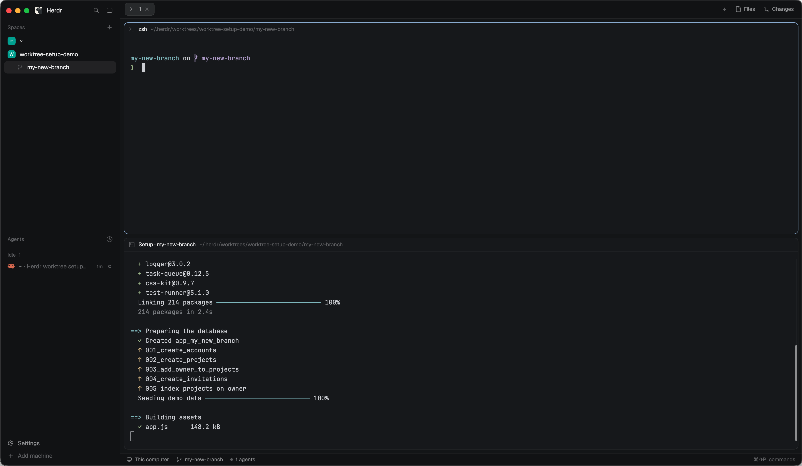

# Worktree setup

When a space opens on a new git worktree, a pane slides in under its first terminal and
runs the repository's setup: it copies gitignored files such as `.env` from the main
checkout, then runs `scripts.setup` from `.herdr/settings.toml` (or Conductor's
`.conductor/settings.toml`, which takes the same keys). When setup
succeeds, the pane closes and a toast says so. When it fails, the pane stays open and asks
whether to run setup again, open a shell in the worktree, or skip setup, and a toast says
what happened. When a worktree it set up is removed, it
runs `scripts.archive` in a background terminal, in a stand-in checkout with the worktree's
folder name, and posts a toast with the result.

## What you see

- Nothing, most of the time. The mod is a floating block that renders an empty `div()`,
  so it takes no space and draws no frame.
- When a new worktree's space opens: a terminal pane splits **down** from the space's first
  pane (half the height). Its header shows the title `Setup · <worktree folder name>`, and
  `Setup failed · <worktree folder name>` once setup fails, with Herdr's icon for an
  unlisted program. It prints, dimmed:
  `Copying files from <main checkout>`, then each copied path indented two spaces (or
  `nothing matched`, or `<path> is already there`); then `Running the setup script` and the
  script's lines, each indented; then the script's own output. It ends with a green
  `✓ Setup finished`, or a red `✗ Setup failed (exit N).` followed by `How would you like
  to proceed?` and three choices, each key in
  bold, indented two spaces: `r  Run setup again`, `s  Open a shell in the worktree (exit to come back here)`,
  `q  Skip setup and close this pane`. Choosing `s` prints, dimmed, `Type exit to come back
  to these choices.` above the shell.
- Toasts (Herdr's `notify`): success `"<name> is set up"` (level success, 4 s). Failure
  `"Setup failed in <name>"`, body `Exit N. Its pane is still open: run setup again, open
  a shell to fix it, or skip.` (level error; clicking it selects that space). A settings
  file that can't be parsed: `"Worktree setup didn't start"` with the file name and line.
  Archive: success `"Cleaned up after <name>"` (level success, 4 s). Failure `"Cleanup
  failed after <name>"`, body `Exit N. Click to see its output (or run: hc read <address>).`
  (level error; clicking it runs `terminal.peek` on that terminal). One that can't start:
  `"Cleanup after <name> didn't start"` with the reason.

## How it behaves

- The pane above (usually an agent) keeps the keyboard: the mod refocuses it right after
  the split.
- A worktree counts as new when it has no marker file and was made after the mod was
  installed. The install time is stored in `shared("worktree-setup.installed-at")` (unix
  seconds) on the first start.
- A repository gets a pane only when some level sets `scripts.setup`, `scripts.archive` or
  `file_include_globs`, or it has a `.worktreeinclude`. Files that exist but set none of
  those (Conductor's own `~/.conductor/settings.toml` usually holds only model and git
  preferences) don't count, and nor does the `.env*` default.
- Success: the runner writes `ok` to the marker and exits, and the pane closes itself. The
  mod, polling every 1.5 s while a setup is open, posts the success toast.
- Failure: the runner writes `failed N` and waits for one key (`read -r -s -n 1`, upper or
  lower case; anything else is ignored, without printing the choices again).
  - `r` writes `retry` and ends the runner, which closes the pane. The mod then reads the
    settings again and opens a fresh setup pane in the same place.
  - `s` starts a login shell in the worktree, with the `HERDR_*` and `CONDUCTOR_*` variables
    set, run as `worktree-setup` with `DISABLE_AUTO_TITLE=true`. When it exits, the runner
    sets the title again and shows the choices again.
  - `q`, or stdin closing, ends the runner with the marker still `failed N`, so it isn't
    retried. Closing the pane does the same.
- Reloads and restarts: the mod keeps its setups in memory, so when it starts it looks again
  at every space. A worktree whose marker says `failed` or `running` and whose setup pane is
  still open is followed again, with no second failure toast. Its pane is the live terminal
  whose command includes `WORKTREE_SETUP_MARKER=<marker>`. A marker saying `retry` (`r`
  pressed while nothing was watching) launches setup again. Anything else is left alone.
- Removal: every worktree the mod launched a setup for is remembered. It counts as removed
  once `<worktree>/.git` is gone. The mod checks 5 s after it starts (catching removals while
  Herdr was closed), 3 s after the number of spaces drops (Herdr's Remove worktree closes the
  space, then removes the checkout), and every 60 s. It forgets a removed worktree, frees its
  ports, and runs `scripts.archive` (if set) in a background terminal with no pane. A machine
  it can't reach is checked again next time.
- Agent statuses: it doesn't show any.
- No clicks or keys of its own.

## Built from

- Layout: one floating block on the root node:
  `{ "id": "worktree-setup", "content": { "mod": "worktree-setup" }, "edge": "bottom", "align": "end" }`.
  `mod.json` is `{ "place": "none" }`.
- `main.js` (the View): `render()` walks `spaces()`. For each space not seen before whose
  first tab already has a terminal pane (`panes()`), it checks the worktree with `exec("git", …)`:
  - `rev-parse --path-format=absolute --show-toplevel --git-dir --git-common-dir`. Linked
    when git-dir differs from common-dir; the main checkout is common-dir without `/.git`.
  - `readTextFile("<git-dir>/herdr-worktree-setup")` must be null.
  - `log -g --date=unix --format=%gd HEAD`: the oldest `HEAD@{<unix>}` is the creation time.

  It then reads every file in `settings.js`'s `FILES` with `readTextFile` (each entry says
  whether its path is under the main checkout or the home folder). Then `run("pane.split", { direction: "down", pane, argv })` with
  `argv = ["env", "NAME=value"…, "bash", "-c", 'exec -a worktree-setup bash -c "$1"',
  "worktree-setup", RUNNER]` (`SETUP_ARGV`), and `run("pane.focus", { pane })`.
  `cx.timer.every(1500)` polls the marker files of open setups, and running cleanups with
  `hc(["get", address, "--json"])` until `state` is `finished` (exit 0: toast, then
  `hc(["rm", address])`). The same timer starts the removal sweep when it's due. The cleanup
  terminal is `hc(["run", "--bg", "--json", "--no-parent", "--no-notify", "--on", machine?,
  "--cwd", <main checkout>, "--", "env", "NAME=value"…, "bash", "-c", ARCHIVE_RUNNER])`. It uses
  `notify`, `shared` / `setShared` (install time; `worktree-setup.worktrees`, which maps each
  worktree path to `{ root, port, on, branch }`; `branch` is read from `<git-dir>/HEAD` at
  launch and at every sweep while the worktree exists, null when detached), `home`, and `exec("sh", ["-c", 'printf %s "$HOME"'],
  { on })` on other machines.
- `settings.js`: three levels, first match wins: local > repo > user. Each level merges its
  files key by key, later winning:
  - local: `.conductor/settings.local.json`, `.conductor/settings.local.toml`,
    `.herdr/settings.local.toml`
  - repo: `conductor.json` (only while `.conductor/settings.toml` is absent),
    `.conductor/settings.json`, `.conductor/settings.toml`, `.herdr/settings.toml`
  - user: `~/.conductor/settings.json`, `~/.conductor/settings.toml`,
    `~/.config/herdr-app/worktree-setup.toml`

  So a level never loses to a lower one, and within a level Herdr's file beats Conductor's. Files to copy: `.worktreeinclude`, else
  `file_include_globs` (string or array), else `.env*`. Environment: `environment_variables`
  plain values, overridden by `environment_variables.local`; `cloud` is ignored.
  `configured` is true only when the resolved `scripts.setup` or `scripts.archive` is
  non-blank, `file_include_globs` is set at some level, or `.worktreeinclude` exists.
- `toml.js`: a small TOML reader (tables, arrays of tables, dotted and quoted keys, all four
  string forms, numbers, booleans, arrays, inline tables; dates kept as text). Its errors
  name the line.
- `runner.js`: the bash script, as a `String.raw` template. Its inputs come from the
  environment:
  - `CONDUCTOR_ROOT_PATH`, `CONDUCTOR_WORKSPACE_PATH`, `CONDUCTOR_WORKSPACE_NAME`
  - `WORKTREE_SETUP_INCLUDE`, `WORKTREE_SETUP_SCRIPT`, `WORKTREE_SETUP_MARKER`

  Files to copy are found like this:
  1. `git -C <main> ls-files -z -o -i --exclude-standard --directory` lists the ignored
     entries. Ignored folders come out as one entry and aren't walked.
  2. That list is piped into `git -C <scratch repo> -c core.excludesFile=<patterns>
     check-ignore --no-index -z --stdin`, so git applies the include patterns with real
     `.gitignore` rules, `!` negation included.
  3. Matches are copied with `cp -Rp`, skipping anything that already exists and anything
     inside a folder that was just copied.

  The setup script runs with `zsh -c` (else `bash -c`), after `use_shell_path`. That's a
  bash function both runners start with (`SHELL_PATH`). It runs
  `"$SHELL" +m -lic 'printenv PATH > "$WORKTREE_SETUP_PATH_FILE"'` in the current folder,
  in the background, with `DISABLE_AUTO_UPDATE=true` and stdin, stdout and stderr on
  `/dev/null`. It polls every 0.1 s and kills the shell after `WORKTREE_SETUP_SHELL_WAIT`
  seconds (default 10). If the file isn't empty, it exports that as `PATH`. Only for a
  `$SHELL` ending in `/zsh` or `/bash`; otherwise, or on failure, the runner prints, dimmed,
  `with Herdr's PATH: your shell's couldn't be read`.

  `ARCHIVE_RUNNER`, the second script, sets the title `Clean up · <name>` and makes the
  stand-in from `HERDR_ROOT_PATH`: `git worktree add -q <mktemp -d>/<name>
  $WORKTREE_ARCHIVE_BRANCH`, else `--detach` (no branch, or the branch is checked out
  elsewhere), with `-c core.hooksPath=/dev/null` and `GIT_LFS_SKIP_SMUDGE=1`. It prints,
  dimmed, `in a checkout of <branch> at <path>` (or `in a checkout at <path>`), or, when
  both fail, `from the main checkout: a stand-in checkout couldn't be made` and runs there
  instead. Then the script, dimmed, then `zsh -c` (else `bash -c`) on
  `WORKTREE_ARCHIVE_SCRIPT` with stdin from `/dev/null`. An `EXIT` trap runs `git worktree
  remove --force` on the stand-in, deletes the scratch folder and runs `git worktree prune`;
  the exit code is the script's.
- `worktree.js`: pure helpers (rev-parse parsing, creation time, ports, setup variables, env
  arguments, marker parsing, the git folder from a `.git` file, the branch from `HEAD`).
- Variables given to the setup and archive scripts, each as `HERDR_<X>` and `CONDUCTOR_<X>` from one value
  (`setupVariables`): `WORKSPACE_NAME` (the worktree's folder name), `WORKSPACE_PATH`,
  `ROOT_PATH`, `DEFAULT_BRANCH` (from `origin/HEAD`, else `main`), `PORT` (the lowest free
  block of 10 from 55000, kept per worktree). Plus `CONDUCTOR_IS_LOCAL=1` and the settings'
  environment variables (the built-in ones win).
- Programs it runs: `git`, `bash`, `zsh` if present, `env`, `cp`, `mktemp`, `sed`, `sh`,
  `printenv`, `sleep`, the person's `$SHELL` (for its `PATH`), and `hc` for the archive
  terminal. No network.

## Watch out

- Setups live in `this.jobs`, in memory. A mod reload (any save under the mod's folder) or
  a Herdr restart empties it while setup panes stay open. Without `onFirstSight`, a failed
  setup's marker made the worktree look done, and choosing to retry wrote `retry` with
  nothing watching, so setup never ran again.
- A `Map` visits keys added during a `for…of` loop. A retry deletes its job and `launch()`
  re-adds it, so poll over a copy (`[...this.jobs]`), or a retry launches twice.
- `String.raw` keeps a backslash before `${`, so the bash script can't use `${…}` at all.
  Use `case` patterns instead (`case $entry in "$inside"*)`, `sed 's#/$##'`). It can't hold
  a backtick either.
- Herdr's `pane` header labels a shell's pane with the shell's name and ignores its title,
  and it decides what's a shell by argv[0], not the executable. A plain `bash -c RUNNER` pane
  says `bash` throughout, and a failed setup's shell says `zsh`. So both run under
  `exec -a worktree-setup`. The failure shell also gets `DISABLE_AUTO_TITLE=true`, or
  oh-my-zsh retitles the terminal (`user@host:~/path`) at every prompt. Other prompts that
  set a title still win. `exec -a` only works on a program bash starts, which is why the
  failure shell is in a `( … )` subshell: the runner has to outlive it to show the choices
  again.
- Retrying used to be "type exit in the failure shell". People type `exit` to leave, and a
  rerun can be expensive (a setup that rebuilds a database, say), so a failure asks
  instead: one key for `r`, `s` or `q`. A rerun always needs `r`.
- `%ct` in `git log -g` is the commit's date, not the reflog entry's. Use
  `--date=unix --format=%gd`.
- `ls-files -o -i -x <patterns>` without `--exclude-standard` walks `node_modules` and
  copies `.env` files from packages. List the ignored entries first, then match.
- Don't run setup from a `post-checkout` hook or inside `exec`. `exec` has a 30-second
  limit, and setup output belongs in a pane.
- `pane.split` with `argv` runs the program directly: when it exits, the terminal ends and
  its pane closes itself. So the runner opens its own login shell on `s`, and the mod
  must never `pane.close` a setup pane: it races the exit and fails with `no pane "…"`.
- Herdr's terminals get the login shell's `PATH`, not an interactive shell's. On macOS,
  `/etc/zprofile`'s `path_helper` moves `/usr/bin` to the front after `~/.zshenv` has added
  a version manager's folders, and `zsh -c` never reads `~/.zshrc`, which would put them
  back. So a plain `zsh -c "$WORKTREE_SETUP_SCRIPT"` found the system's copy of a tool, not
  the version-managed one a terminal finds. Hence `use_shell_path`. Its gotchas:
  - Read `PATH` from a file, not from the shell's output: terminal shell integrations print
    escape codes during interactive startup.
  - `+m` is required. Without it, the interactive zsh takes the terminal over and leaves a
    dead process group in front: the runner's next read from the terminal fails, so the
    failure shell can't work. Tested in an `hc` pty with zsh and with bash 3.2.
  - Give it no stdin and a time limit: oh-my-zsh's default update mode asks a question at
    startup.
  - Other shells don't all take `+m -lic`, so they're skipped, not guessed at.
- Spaces the person opens on existing worktrees made before install are skipped on purpose.
  Clearing `worktree-setup.installed-at` would make every unmarked worktree look new.
- `space.new` selects the new space, so testing live moves the person's window.
- Assumes `bash` and `git` on the machine (a remote space's machine too). Bare repositories
  have no main checkout and are skipped. Repository settings are read from the main
  checkout's working tree, not the default branch as Conductor does.
- The archive script runs after the worktree is gone: Herdr gives a mod no way in before
  removal. Conductor runs it inside the workspace, and scripts rely on that: one names
  databases after `basename "$PWD"`, runs `git`, and is set as a relative path
  (`bin/…/cleanup.sh`). Run from the main checkout, such a script cleans up after the wrong
  name. Hence the stand-in. Not a symlink to the main checkout: a script that deletes local
  files would delete the main checkout's. It's a full checkout, so it takes seconds in a big
  repo. Its branch is the last one a sweep saw, up to a minute stale.
- Background terminals (`hc run --bg`) have a terminal on stdin. A script that asks "are you
  sure?" when `[ -t 0 ]` would wait forever, so the archive script gets `/dev/null`.
- Only worktrees the mod launched a setup for are tracked, so removing an older worktree runs
  no archive script.
- Don't count a settings file as configuration just because it exists: many people have a
  `~/.conductor/settings.toml` that holds only Conductor's own preferences, and that would
  set up every repo.
- Not built: `scripts.run` actions, `preview_urls`. The `HERDR_*` and `CONDUCTOR_*`
  variables reach the setup pane and the archive terminal only, not the space's other
  terminals.

## Done when

- `herdr-app check ~/.config/herdr-app/mods/worktree-setup` passes, and `herdr-app status`
  shows the `worktree-setup` float with no errors and nothing visible on screen.
- In a repo with `.conductor/settings.toml` setting `scripts.setup`, and a gitignored `.env`
  in the main checkout: `git worktree add` a branch, then open a space on it. A pane opens
  below, copies `.env`, runs the script with `HERDR_PORT` and `CONDUCTOR_PORT` both
  `55000`, closes itself, and a success toast appears.
- The same with only `.herdr/settings.toml`. With both, a key set in `.herdr` wins and the
  others come from `.conductor`. The marker in `.git/worktrees/<name>/herdr-worktree-setup` reads
  `ok`.
- With a `settings.local.toml` setup that ends in `exit 1`, the pane stays open showing the
  failure message and the three choices, and an error toast appears. Other keys do
  nothing. `s` opens a shell, and `exit` there shows the choices again. After fixing the
  file, `r` opens one new pane (not two), which runs the fixed script and closes. `q` closes
  the pane and leaves the marker at `failed 1`.
- A space on a worktree made before install, or in a repo with no Conductor files, gets no
  pane. Neither does one in a repo whose only file is a `~/.conductor/settings.toml` that sets
  no scripts or `file_include_globs`.
- With `scripts.archive` set, removing a worktree that was set up runs the archive script
  within a few seconds, in a folder with the worktree's name, on its branch, and with no
  terminal on stdin. `"Cleaned up after <name>"` appears, and `git worktree list` shows no
  stand-in afterwards. The
  worktree's entry leaves `shared("worktree-setup.worktrees")`.
- After a failed setup, saving a file in the mod's folder (a reload), then fixing the
  settings and pressing `r`, still opens one new setup pane that runs and closes.
- On macOS, with a version manager set up in `~/.zshrc` that provides a tool also in
  `/usr/bin`, a setup script that runs `command -v <tool>` finds the version manager's copy,
  not `/usr/bin/<tool>`.
- `npm test` passes.
